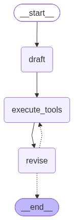
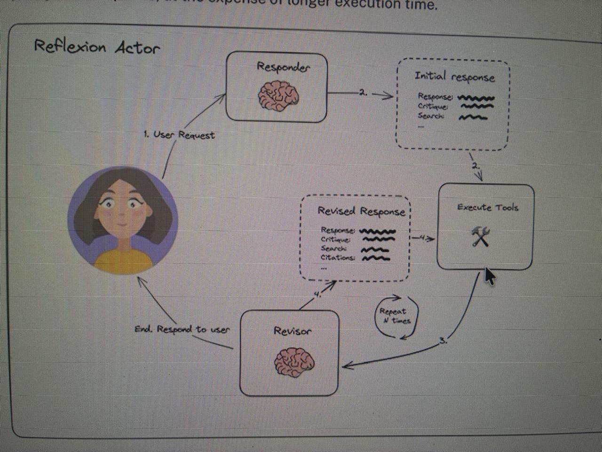

# Actor-Reflection Agent (LangGraph)

Agente de pesquisa que **responde, critica a própria resposta e sugere buscas** para melhorar — o padrão *Actor / Reflection* (base do "Reflexion"). A resposta não sai crua: passa por um ciclo de auto-crítica guiado pelo schema de saída.



## Estrutura

| Arquivo | Papel |
|---|---|
| `schemas.py` | Modelos Pydantic que definem o **formato obrigatório** da saída da LLM |
| `chains.py` | Prompt + LLM + parsers = chains do Actor e do Revisor |
| `tool_executor.py` | Transforma funções Python em tools e executa as buscas (ToolNode) |
| `main.py` | Monta o grafo LangGraph (`Actor → Tools → Revisor` em loop) e roda o exemplo |
| `.env` | Chave de API (não versionado) |

Modelo usado: `z-ai/glm-5.3-flash` via OpenRouter.

## Setup

```bash
uv sync                      # instala dependências
echo 'OPEN_ROUTER_API_KEY=...' >> .env
uv run chains.py             # roda o teste isolado do __main__
uv run main.py               # roda o grafo completo (e gera o flow.png)
```

## Como o grafo funciona (`main.py`)

```python
draft → execute_tools → revise ─┬→ execute_tools   (loop)
                                └→ END
```

- **`draft`** — o Actor responde a pergunta (~250 palavras) e sugere queries de busca.
- **`execute_tools`** — executa as buscas Tavily em paralelo.
- **`revise`** — o Revisor reescreve a resposta com citações e novas queries.
- **`event_loop`** — aresta condicional: conta os `ToolMessage` no estado; enquanto não passou de `MAX_INTERACTION = 2` voltas, volta para `execute_tools`. Acima disso, encerra.

Detalhes que valem saber:

- `StateGraph(MessagesState)` — o estado do grafo é só a lista de mensagens; cada nó retorna `{"messages": [...]}` e o LangGraph acumula (append) em vez de substituir.
- O loop é controlado **contando ToolMessages** — cada passada por `execute_tools` produz uma, então é um contador de iterações de graça, sem variável extra no estado.
- `graph.get_graph().draw_mermaid_png(output_file_path="flow.png")` gera a imagem do fluxo acima (a mesma que ilustra o topo deste README).
- A resposta final está no último `AIMessage`: como o schema força tool call, o texto vem em `last_message.tool_calls[0]["args"]["answer"]`.

## Estado atual e próximos passos

- [x] Schema `AnswerQuestion` (resposta + reflexão + queries de busca)
- [x] Chain do primeiro respondente (Actor)
- [x] `ReviseAnswer` (schema do revisor, com referências) + chain do revisor
- [x] Executor de tools (`tool_executor.py`) com busca Tavily
- [x] Grafo LangGraph: `Actor → Tools → Revisor` em loop (`main.py`, máx. 2 iterações)

## Ciclo completo (para onde o projeto vai)

Diagrama de referência do padrão (*Reflexion Actor*) e o grafo real gerado por `main.py`:

| Diagrama de referência | Grafo real (`flow.png`) |
|---|---|
|  |  |

```
Pergunta → Actor (responde ~250 palavras)
        → Reflection (critica: o que falta / o que sobra)
        → Busca web com search_query (Tavily)
        → Revisor reescreve com citações numéricas → repete até qualidade aceitável
```

---

# 📚 Notas de estudo — como pensar e fazer as coisas

> Seção de consulta futura. Todo o raciocínio que estava nos comentários do código foi movido para cá.

## 1. Ordem de raciocínio ao construir uma chain

```
Objetivo (ciclo de melhoria)
   ↓
Que dados preciso a cada volta?   → schema (schemas.py)
   ↓
Como garantir esse formato?       → bind_tools + tool_choice
   ↓
O que a model precisa saber?      → prompt (+ hora atual)
   ↓
Como reaproveitar o prompt?       → partial
   ↓
Funciona isolado?                 → chain de teste no __main__
```

Sempre comece pelo **schema**: ele é o contrato. Todo o resto (prompt, ferramentas, parser) existe para satisfazê-lo.

## 2. Schema Pydantic como contrato com a LLM

As `description` de cada `Field` são **enviadas à model como instrução** — elas dizem o que colocar em cada campo. Por isso são importantes: sem elas a model não sabe o que preencher. Escrevê-las bem é escrever prompt.

```python
answer: str = Field(description="~250 word detail answer to the question")
```

`Reflection` fica **dentro** de `AnswerQuestion` — assim a crítica é parte obrigatória da resposta, não um passo opcional que a model pode pular.

## 3. Forçando o formato: `bind_tools` + `tool_choice`

`bind_tools(tools=[AnswerQuestion])` diz à model: "você tem uma ferramenta chamada AnswerQuestion com este formato de argumentos". `tool_choice="AnswerQuestion"` **obriga** a chamá-la. Sem isso, ela poderia responder em texto livre e quebrar o parser.

## 4. Parsers: duas formas de ler a mesma saída

- `JsonOutputToolsParser(return_id=True)` — retorna dicts crus.
- `PydanticToolsParser(tools=[AnswerQuestion])` — pega os args e constrói objetos `AnswerQuestion` **validados**. Assim `res[0].answer` e `res[0].search_queries` funcionam como atributos, com validação de tipos. Preferível quando os dados vão alimentar o próximo passo do grafo.

## 5. Por que a hora atual no prompt?

A LLM não sabe que dia é hoje — ela só conhece o que viu no treino. Colocando `Current time: ...` no prompt, ela sabe a data atual, útil para pesquisa ("startups que levantaram capital em 2026").

## 6. `partial`: preenchendo variáveis antecipadamente

O prompt tem variáveis entre chaves: `{time}` e `{first_instruction}`. Normalmente você teria que passar todas no `invoke`. O `.partial(...)` preenche algumas antecipadamente, deixando só o resto para depois.

## 7. `lambda` no time — o detalhe que pega muita gente

```python
.partial(time=lambda: datetime.datetime.now().isoformat())
```

`time` usa lambda para ser **calculado a cada chamada**. Se fosse `time=datetime.now()` sem lambda, a hora seria fixada uma vez só, no momento em que o arquivo foi carregado.

## 8. Reaproveitando o template (camadas)

```python
first_responder_prompt_template = actor_reflection_prompt.partial(
    first_instruction="Provide a detailed ~250 word answer"
)
```

A Camada 2 reaproveita o template base e só preenche `first_instruction`. O mesmo esqueleto de prompt servirá para o nó de Reflection trocando só a instrução — é assim que o ciclo Actor/Reflection compartilha estrutura sem duplicar código.

## 9. Padrão de teste isolado

O bloco `if __name__ == "__main__":` roda a chain completa (prompt → LLM → parser) com uma pergunta real. Serve para validar o schema e o prompt **antes** de plugar no grafo do LangGraph — cada peça funciona isolada primeiro.

## 10. Schema de revisão: herança em vez de repetição

```python
class ReviseAnswer(AnswerQuestion):
    """Revise your original answer to your question."""
    references: list[str] = Field(description="Citations motivating your updated answer.")
```

O revisor precisa de tudo que o Actor produzia **mais** as referências. Herdar de `AnswerQuestion` dá isso de graça: mesmos campos, mesma validação, e só o campo novo é declarado. O docstring também importa — ele é a descrição que a model vê da tool.

As instruções de revisão pedem **citações numéricas** (`[1] https://...`) — sem isso a model diria "segundo fontes" e o texto não seria verificável. O `references` do schema é onde essas URLs moram.

## 11. O problema central: o framework não entende uma função sozinha

Uma função Python comum é invisível para a LLM e para o LangGraph. Ela só existe no seu processo. Para o ecossistema usar uma função, ela precisa ser transformada em uma **tool** — um objeto com:

- **nome** (como a LLM se refere a ela)
- **descrição** (como a LLM decide quando/chamá-la)
- **schema de argumentos** (o formato do que a LLM deve enviar)

`StructuredTool.from_function` faz essa conversão: pega a função Python comum e a embrulha nesse formato que o framework entende. A partir daí, `ToolNode`, `bind_tools` e a própria LLM conseguem "enxergar" e chamar a função.

## 12. Por que `name=AnswerQuestion.__name__` conecta tudo

```python
StructuredTool.from_function(run_queries, name=AnswerQuestion.__name__)
```

A LLM chama tools **pelo nome**. O `tool_choice="AnswerQuestion"` na chain força a model a emitir um tool call com `name="AnswerQuestion"`. O `ToolNode` recebe esse tool call e **procura uma tool registrada com esse mesmo nome**. Nomear a tool com `AnswerQuestion.__name__` (a string `"AnswerQuestion"`) fecha o circuito: a model pede "AnswerQuestion" → o ToolNode acha a tool → executa a função.

Por isso existem **duas** registrations da mesma `run_queries`: quando o tool call vier do Actor (`AnswerQuestion`) ou do Revisor (`ReviseAnswer`), o ToolNode precisa achar uma tool em ambos os casos. A função é a mesma; o nome é o que roteia.

## 13. Por que `**kwargs` na função

O tool call traz **todos** os campos do schema: `answer`, `reflection` e `search_query`. Mas a função só precisa das queries. O `**kwargs` absorve os campos extras sem dar erro — sem ele, a chamada falharia com argumentos inesperados.

**E o nome do parâmetro importa:** o ToolNode passa os argumentos **pelo nome**. O schema usa `search_query`, então o parâmetro da função tem que se chamar exatamente `search_query` — se a função declarasse `queries`, chegaria vazio (na verdade, daria erro por campo obrigatório ausente). Regra: **o nome do parâmetro = o nome do campo no schema**.

## 14. O que cada peça do `tool_executor.py` faz

```python
tavily_tool = TavilySearch(max_results=5)   # a busca real (web), 5 resultados por query

def run_queries(search_query: list[str], **kwargs):
    return tavily_tool.batch([{"query": q} for q in search_query])
    # .batch executa todas as queries em paralelo; retorna
    # [{"query": "...", "results": [...5 resultados...]}, ...]

execute_tools = ToolNode([...])  # nó pronto do LangGraph que:
    # 1. pega a última AIMessage (com tool_calls)
    # 2. para cada tool call, acha a tool pelo name
    # 3. executa com os args
    # 4. devolve ToolMessage com o resultado e o tool_call_id correto
```

Sem o ToolNode você escreveria esse roteamento à mão dentro de um nó custom do LangGraph. Ele é o "trabalho chato" padronizado.
